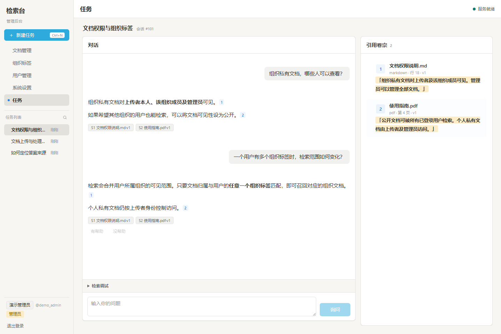
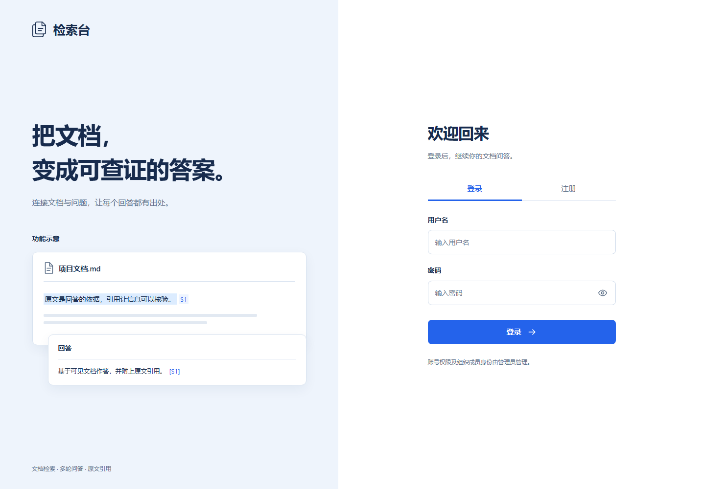
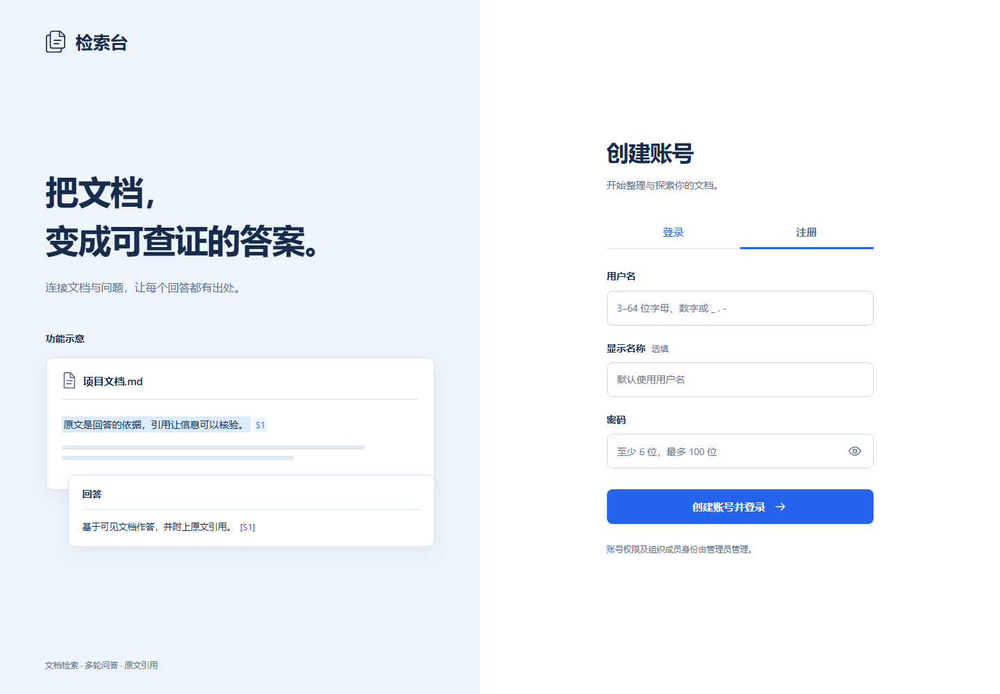
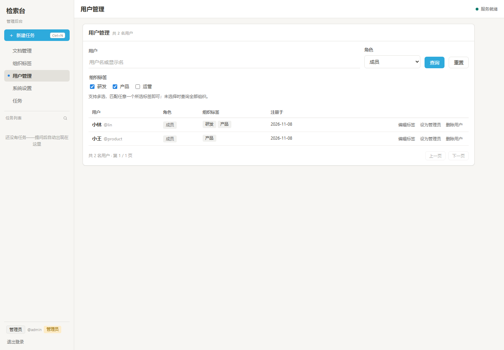
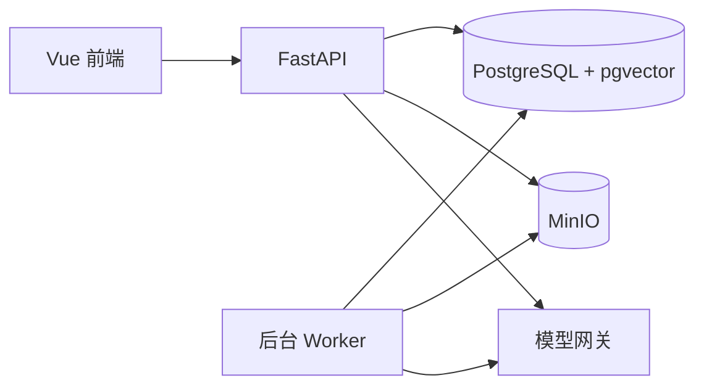

# 检索台

基于传统 NLP 与混合检索的文档问答系统，为个人和团队提供文档管理、带引用的问答与组织权限管理。

系统使用 BM25 和向量语义检索召回证据，再由大模型生成可追溯到原文的回答。业务数据与向量存储于 PostgreSQL，原始文档存储于 MinIO。

Python 3.11–3.12 · FastAPI · PostgreSQL + pgvector · MinIO · Vue 3

项目包名为 `nlp-powered-rag-system`。

## 目录

- [功能特性](#功能特性)
- [项目展示](#项目展示)
- [系统架构](#系统架构)
- [技术栈](#技术栈)
- [快速开始](#快速开始)
- [配置说明](#配置说明)
- [使用指南](#使用指南)
- [接口文档](#接口文档)
- [项目结构](#项目结构)
- [开发与测试](#开发与测试)
- [常见问题](#常见问题)
- [贡献指南](#贡献指南)
- [许可证](#许可证)

## 功能特性

| 功能 | 说明 |
| --- | --- |
| 文档处理 | 支持 TXT、Markdown、DOCX、PDF，包含格式校验、文本清洗、切块与向量化 |
| 混合检索 | BM25 与向量独立召回，结合 RRF 融合、规则重排与 MMR 证据选择 |
| 问答与引用 | 支持流式回答、多轮追问与 `[S1]` 形式的原文引用，证据不足时给出拒答结果 |
| 文档权限 | 按上传者、组织归属和公开／私有可见性过滤文档与检索结果 |
| 会话管理 | 保存问答历史，支持新建、查看、继续追问与删除会话 |
| 管理功能 | 管理组织标签、用户角色与成员关系，支持用户条件查询、分页和删除 |
| 任务处理 | 上传与重建通过后台 worker 执行，提供任务状态、租约恢复和快照发布机制 |
| 审计与反馈 | 保存问答及引用记录，支持用户反馈、请求标识和结构化日志 |

## 项目展示

以下为当前界面的浏览器截图，用户、组织、文档与问答内容均为演示数据。

### 文档问答与原文引用

在同一页面查看历史会话、多轮问答与引用原文。点击回答中的引用标记，可定位对应的证据。



<details>
<summary>登录与注册</summary>

账号登录与注册使用统一的表单布局，提供密码显隐、输入校验和提交状态提示。





</details>

<details>
<summary>用户管理与组织标签筛选</summary>

按用户名、角色和组织标签组合查询。图中同时选择「研发」与「产品」，匹配任意一个标签的用户即可出现在结果中。



</details>

## 系统架构



- 文档入库时，API 保存原文件与任务记录，worker 完成解析、NLP 处理和向量化，再发布索引快照。
- 提问时，服务按用户权限过滤可见内容，执行双路召回与证据选择，随后生成回答、校验引用并写入审计记录。
- 数据库承担持久化存储，检索服务按快照与修订号装载运行时内存索引。内部以主空间承载文档和索引。

## 技术栈

| 模块 | 技术 |
| --- | --- |
| 后端 | Python 3.11–3.12、FastAPI、Uvicorn、Pydantic |
| 数据访问 | SQLAlchemy 2、psycopg 3 |
| 数据与向量 | PostgreSQL、pgvector，向量维度固定为 1024 |
| 对象存储 | MinIO，使用 S3 兼容接口 |
| 传统 NLP | jieba、TF-IDF、BM25、规则分句与切块 |
| 模型接入 | OpenAI 兼容协议，默认模型为 `text-embedding-v4` 和 `qwen3.8-flash` |
| 前端 | Vue 3、Vue Router、Vite、Marked、DOMPurify |
| 开发工具 | uv、npm、pytest、Ruff、Node.js Test Runner |

## 快速开始

### 1. 准备环境

| 依赖 | 要求 |
| --- | --- |
| Python | 3.11 或 3.12，项目默认使用 3.12 |
| uv | 用于安装 Python 依赖与运行后端 |
| Node.js 与 npm | 建议 Node.js 22 或更高的 LTS 版本，用于构建前端 |
| PostgreSQL | 建议 16 或 17，并安装 pgvector 扩展 |
| MinIO | 提供 API 地址、访问凭据与文档存储桶 |
| Docker | 使用下方本地依赖示例时需要 |

获取项目后，请在项目根目录执行后续操作。命令以 PowerShell 为例。Linux／macOS 可使用相同的 Git、Docker、uv 和 npm 命令，配置文件复制使用 `cp .env.example .env`。

<details>
<summary>使用 Docker 启动本地 PostgreSQL 与 MinIO</summary>

示例将服务端口绑定到本机回环地址，数据保存在 Docker 卷中。

```powershell
docker run -d --name nlp-rag-postgres -e POSTGRES_DB=nlp_rag -e POSTGRES_PASSWORD=postgres -p 127.0.0.1:5433:5432 -v nlp-rag-postgres-data:/var/lib/postgresql/data pgvector/pgvector:pg17

docker run -d --name nlp-rag-minio -e MINIO_ROOT_USER=admin -e MINIO_ROOT_PASSWORD=nlprag-local-secret -p 127.0.0.1:9000:9000 -p 127.0.0.1:9001:9001 -v nlp-rag-minio-data:/data quay.io/minio/minio:latest server /data --console-address ":9001"
```

PostgreSQL 数据库名为 `nlp_rag`。MinIO API 端口为 `9000`，控制台端口为 `9001`。使用已有服务时，按实际连接信息填写 `.env`。

</details>

### 2. 获取项目并安装依赖

```powershell
git clone https://gitee.com/yyd520/nlp-powered-rag-system.git
cd nlp-powered-rag-system

uv sync
Copy-Item .env.example .env
npm --prefix frontend ci
```

### 3. 配置环境变量

生成 JWT 签名密钥，将输出填入 `.env` 的 `JWT_SECRET`。

```powershell
uv run python -c "import secrets; print(secrets.token_urlsafe(48))"
```

使用上述 Docker 服务时，填写以下配置。其余参数可沿用 `.env.example`。

```dotenv
APP_ENV=development
JWT_SECRET=<填入生成的随机密钥>

PG_HOST=127.0.0.1
PG_PORT=5433
PG_DATABASE=nlp_rag
PG_USER=postgres
PG_PASSWORD=postgres

MINIO_ENDPOINT=127.0.0.1:9000
MINIO_BUCKET=nlprag
MINIO_ACCESS_KEY=admin
MINIO_SECRET_KEY=nlprag-local-secret
MINIO_SECURE=false
```

开发环境在模型凭据缺省时使用 Mock 网关联调。接入真实模型时，同时填写以下两项，并确认账号可访问配置中的模型。

```dotenv
MODEL_BASE_URL=https://dashscope.aliyuncs.com/compatible-mode/v1
DASHSCOPE_API_KEY=<填入模型服务密钥>
```

### 4. 初始化数据库与存储桶

首次部署时执行以下代码，创建 pgvector 扩展、业务表、上传状态表及 MinIO 存储桶。数据库账号需要具备对应的创建权限。

```powershell
@'
from minio import Minio
from sqlalchemy import text

import app.db.models
import app.db.upload_guard
from app.core.config import get_settings
from app.db.base import Base
from app.db.session import engine

with engine.begin() as connection:
    connection.execute(text("CREATE EXTENSION IF NOT EXISTS vector"))
    Base.metadata.create_all(connection)

settings = get_settings()
storage = Minio(
    settings.minio_endpoint,
    access_key=settings.minio_access_key,
    secret_key=settings.minio_secret_key,
    secure=settings.minio_secure,
)
if not storage.bucket_exists(settings.minio_bucket):
    storage.make_bucket(settings.minio_bucket)

engine.dispose()
print("Initialization complete.")
'@ | uv run python -
```

在 Bash／Zsh 中，可将外层 PowerShell here-string 换为 `uv run python - <<'PY'` 与结尾的 `PY`，中间 Python 代码相同。

`create_all` 用于建立缺失的表。已有数据库的字段、索引与约束升级由部署方管理，升级前应核对当前 ORM 定义。

### 5. 构建前端并启动服务

```powershell
npm --prefix frontend run build
```

在两个终端中分别启动 API 和 worker，并保持工作目录为项目根目录。

```powershell
# 终端 1
uv run uvicorn app.main:app --host 127.0.0.1 --port 8000 --reload
```

```powershell
# 终端 2
uv run python -m app.workers
```

| 地址 | 用途 |
| --- | --- |
| [应用首页](http://127.0.0.1:8000) | 登录、注册与文档问答 |
| [Swagger UI](http://127.0.0.1:8000/docs) | 交互式接口文档 |
| [OpenAPI](http://127.0.0.1:8000/openapi.json) | 接口描述 |
| [存活检查](http://127.0.0.1:8000/healthz) | API 进程状态 |
| [就绪检查](http://127.0.0.1:8000/readyz) | 数据库连接与 pgvector 扩展状态 |

主空间在首次上传或问答时按需创建。API 从 `frontend/dist` 托管前端构建产物。

### 6. 配置首位管理员

先通过页面注册账号，再由数据库维护者连接应用数据库，将该账号提升为管理员。将下方 `your_username` 替换为注册时使用的用户名。

```sql
UPDATE app_user
SET is_admin = TRUE
WHERE username = 'your_username';
```

使用 Docker 示例时，可通过以下命令进入数据库客户端。

```powershell
docker exec -it nlp-rag-postgres psql -U postgres -d nlp_rag
```

确认更新了一条记录后，重新登录或刷新页面。后续管理员与组织成员关系通过「用户管理」维护。

## 配置说明

完整配置示例与字段定义分别见仓库内的配置文件。环境变量覆盖 `.env` 中的同名项。[`.env.example`](.env.example) · [配置定义](app/core/config.py)

| 配置项 | 默认值 | 说明 |
| --- | --- | --- |
| `APP_ENV` | `development` | 开发环境允许使用 Mock 网关，生产部署设为 `production` |
| `JWT_SECRET` | 空 | JWT 签名密钥，建议使用随机生成的独立密钥 |
| `JWT_EXPIRE_DAYS` | `7` | 登录凭据有效天数 |
| `PG_HOST` / `PG_PORT` | `127.0.0.1` / `5433` | PostgreSQL 连接地址 |
| `PG_DATABASE` / `PG_USER` / `PG_PASSWORD` | `nlp_rag` / `postgres` / `postgres` | 数据库名称与连接凭据 |
| `MINIO_ENDPOINT` / `MINIO_BUCKET` | `127.0.0.1:9000` / `nlprag` | 对象存储 API 地址与桶名称 |
| `MINIO_ACCESS_KEY` / `MINIO_SECRET_KEY` | `admin` / 空 | 对象存储访问凭据 |
| `MINIO_SECURE` | `false` | 使用 HTTPS 连接 MinIO |
| `MODEL_BASE_URL` / `DASHSCOPE_API_KEY` | 空 | OpenAI 兼容接口地址与模型服务凭据 |
| `EMBEDDING_MODEL` / `EMBEDDING_DIM` | `text-embedding-v4` / `1024` | 向量模型与固定维度 |
| `CHAT_MODEL` | `qwen3.8-flash` | 问答模型 |
| `MAX_UPLOAD_BYTES` | `20971520` | 默认上传上限 20 MiB |
| `WORKER_LEASE_SECONDS` | `300` | 后台任务租约时长 |
| `WORKER_POLL_INTERVAL_SECONDS` | `2` | worker 轮询间隔 |
| `INDEX_CACHE_BUDGET_MB` | `256` | 运行时索引缓存预算 |
| `CLEANUP_RETENTION_HOURS` | `24` | 软删除内容与旧快照的清理保留时间 |

旧部署中的 `API_TOKEN` 可用于派生 JWT 签名密钥。账号认证使用登录接口签发的 JWT，管理员权限取自用户记录的 `is_admin`。

前端 API 路径为 `/api/v1`，与后端默认 `API_PREFIX` 配套。调整后端前缀时，需要同步修改前端客户端和开发代理。

## 使用指南

### 文档问答

1. 注册并登录，在「文档管理」上传 TXT、Markdown、DOCX 或 PDF 文件。
2. 选择文档归属和可见性，等待后台任务完成索引。
3. 进入「任务」提出问题，查看回答及对应的原文引用。
4. 继续追问，或从侧栏打开历史会话。

### 文档可见性

用户可拥有多个组织标签，每份文档可归属个人或一个组织。管理员可管理全部文档，普通用户的可见范围如下。

| 归属 | 可见性 | 普通用户可见范围 |
| --- | --- | --- |
| 个人 | 私有 | 上传者本人 |
| 个人 | 公开 | 所有已登录用户 |
| 组织 | 私有 | 上传者本人及该组织成员 |
| 组织 | 公开 | 所有已登录用户 |

组织成员身份由管理员分配。删除组织标签后，其文档归属回到上传者个人，文档原有的公开／私有属性继续生效。

### 用户管理

- 支持按用户名或显示名、角色及组织标签组合查询。
- 多个组织标签按任意匹配筛选，同一用户命中多个标签时只返回一次。其他查询条件与标签条件共同生效。
- 支持分页、修改组织标签、授予和撤销管理员权限。
- 删除账号时，清理成员关系与会话，保留已上传文档和问答审计记录。当前登录账号及最后一名管理员受到删除保护。

### 文件存储与清理

原文件对象键按 `年/月/日/用户ID/文件名去扩展名/原始文件名` 组织，数据库保存对象 URI 与内容摘要。

同一用户在同一天上传同名文件时，可能写入相同对象键。上传流程会先使旧引用失效，再删除旧对象并写入新内容。远端写入或删除结果不确定时，对象屏障进入待核查状态，需确认存储端状态后处理。

文档删除先逻辑失效，再由清理任务按保留期处理快照和对象。普通业务失败和延期清理任务需要在问题解决后重新调度，修订号冲突任务会在尝试次数范围内重新排队。

## 接口文档

默认业务接口前缀为 `/api/v1`。认证后通过 `Authorization: Bearer <access_token>` 传递 JWT。

| 模块 | 主要接口 |
| --- | --- |
| 账号 | `POST /auth/register`、`POST /auth/login`、`GET /auth/me` |
| 文档 | `GET /documents`、`POST /documents`、`PATCH /documents/{id}`、`DELETE /documents/{id}` |
| 问答 | `POST /qa`、`POST /qa/stream` |
| 引用与反馈 | `GET /citations/{id}`、`POST /feedback` |
| 会话 | `GET /conversations`、`POST /conversations`、`GET /conversations/{id}`、`DELETE /conversations/{id}` |
| 任务 | `GET /jobs/{id}` |
| 检索调试 | `POST /retrieval/debug` |
| 组织管理 | `GET /admin/org-tags`、`POST /admin/org-tags`、`PATCH /admin/org-tags/{id}`、`DELETE /admin/org-tags/{id}` |
| 用户管理 | `GET /admin/users`、`PATCH /admin/users/{id}`、`DELETE /admin/users/{id}`、`PUT /admin/users/{id}/org-tags` |
| 索引管理 | `POST /admin/reindex` |

问答请求示例，JWT 使用登录响应中的 `access_token`。

```http
POST /api/v1/qa HTTP/1.1
Host: 127.0.0.1:8000
Authorization: Bearer <access_token>
Content-Type: application/json

{
  "question": "文档中对报销流程有哪些规定？",
  "top_k": 6
}
```

管理员按两个组织标签查询用户的示例。

```http
GET /api/v1/admin/users?org_tag_ids=1&org_tag_ids=2&limit=20&offset=0 HTTP/1.1
Host: 127.0.0.1:8000
Authorization: Bearer <access_token>
```

接口字段、响应结构及内部兼容的 `/kbs` 接口，以运行实例的 OpenAPI 文档为准。[Swagger UI](http://127.0.0.1:8000/docs)

## 项目结构

```text
nlp-powered-rag-system/
├── app/
│   ├── main.py              # API 入口与前端静态文件托管
│   ├── api/                 # 业务路由与管理接口
│   ├── core/                # 配置、认证、日志和错误处理
│   ├── db/                  # ORM、数据库会话与上传状态表
│   ├── storage.py           # MinIO 对象存储适配
│   ├── parsers/             # TXT、Markdown、DOCX、PDF 解析
│   ├── nlp/                 # 清洗、分句、分词、关键词与切块
│   ├── indexing/            # 索引快照、缓存与清理
│   ├── retrieval/           # 双路召回、融合、重排与证据选择
│   ├── generation/          # 上下文、回答生成、引用校验与审计
│   ├── gateways/            # 模型调用、重试、预算和 Mock 实现
│   └── workers/             # 后台任务领取、执行与租约管理
├── frontend/
│   ├── src/                 # Vue 页面、组件、路由与状态
│   ├── tests/               # API 客户端测试
│   ├── package.json
│   └── package-lock.json
├── tests/                   # 后端离线回归测试
├── docs/
│   └── images/              # README 项目展示截图
├── .env.example             # 环境变量示例
├── .python-version          # 默认 Python 版本
├── pyproject.toml           # Python 依赖与检查配置
└── uv.lock                  # Python 依赖锁文件
```

## 开发与测试

### 前端热更新

API 和 worker 运行期间，在另一个终端启动 Vite。

```powershell
npm --prefix frontend run dev
```

访问开发服务，API 请求由 Vite 代理到后端。[前端开发页](http://localhost:5173)

### 质量检查

```powershell
uv run pytest
node --test frontend/tests/api.test.js
uv run ruff check app tests
npm --prefix frontend run build
```

后端回归测试使用内存 SQLite 与 mock，覆盖认证、权限、用户管理、任务重试与快照发布。前端测试覆盖 API 客户端、JWT 请求和 SSE 解析。PostgreSQL 行锁、MinIO 远端操作与真实模型效果需在对应环境中验证。

## 常见问题

### 首页返回 JSON，如何打开页面？

执行 `npm --prefix frontend run build`，在构建完成后重新启动 API。应用在启动时检查 `frontend/dist`，随后托管前端页面。

### 上传任务一直排队怎么办？

确认 `uv run python -m app.workers` 正在运行，并检查任务接口及 worker 日志中的错误信息。API 与 worker 应使用同一份数据库、MinIO 和模型配置。

### 账号登录后如何获得管理员权限？

已有管理员可在「用户管理」授权。首次部署由数据库维护者按快速开始中的步骤配置首位管理员。

### 为什么开发环境的回答带有 Mock 特征？

`APP_ENV=development` 且模型配置缺省时，模型工厂会选择 Mock 实现。填写真实模型凭据并重启 API 与 worker，随后重建文档索引，再评估问答效果。

### 切换向量模型后需要做什么？

保持 `EMBEDDING_DIM=1024`，确认新模型输出维度一致，再执行全量重建，使文档向量与查询向量使用同一模型。

### 删除文档后何时释放存储空间？

物理清理取决于保留期、快照引用和任务执行结果。保留期默认 24 小时。延期或失败的清理任务需在满足条件后重新调度。

## 贡献指南

提交 Issue 时，请提供复现步骤、运行环境、相关配置项名称及脱敏后的错误信息。功能变更应说明使用场景、行为变化与验证方式。

提交代码前，请运行「质量检查」中的命令，并为新增行为或修复的问题提供相应的回归验证。

## 许可证

许可证待维护者明确。使用、修改或分发前，请与维护者确认授权条款。
